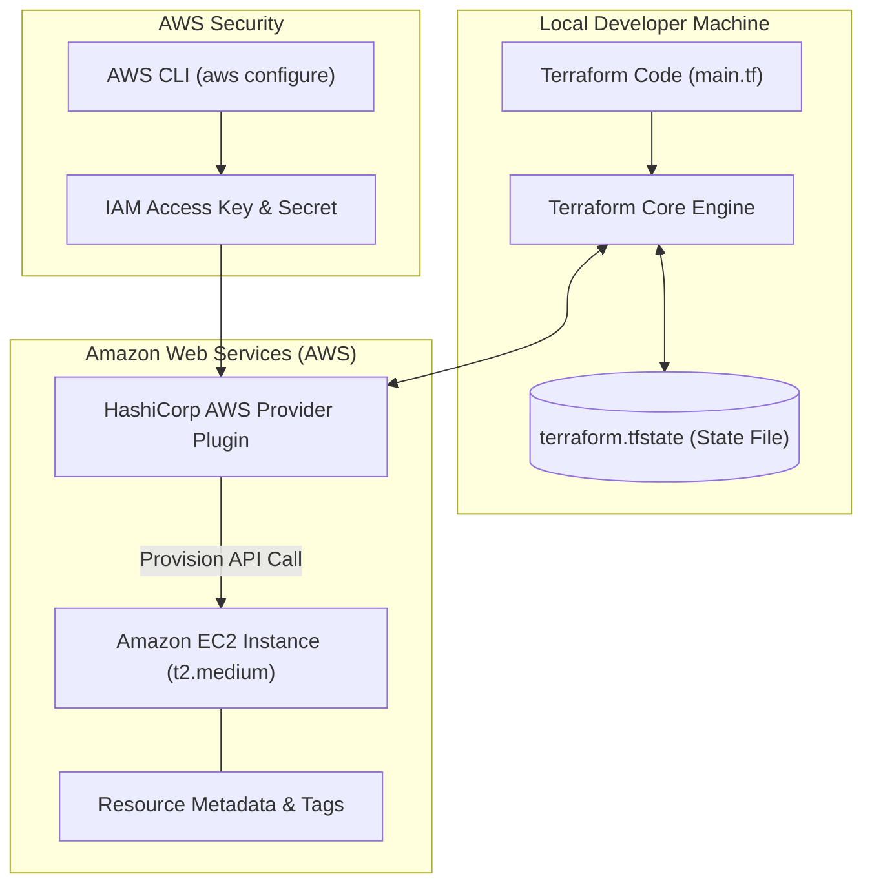

# Terraform Hands-On Training: Provision AWS Infrastructure as Code

<div align="center">

[](https://github.com/codewithmuh/terraform-training/releases)
[](https://opensource.org/licenses/MIT)
[](https://github.com/codewithmuh/terraform-training/stargazers)
[](https://github.com/codewithmuh/terraform-training/network/members)
[](https://www.terraform.io/)
[](https://aws.amazon.com/ec2/)
[](https://youtu.be/bUmGc8Sd3Cw)

**A beginner-friendly, hands-on lab guide to mastering Terraform Infrastructure as Code (IaC) by automating AWS cloud infrastructure and EC2 server provisioning.**

[Overview](#overview) • [Architecture](#terraform-iac-lifecycle--architecture) • [Prerequisites](#prerequisites--installation) • [Step-by-Step Lab](#hands-on-step-by-step-lab) • [Command Reference](#terraform-command-cheatsheet) • [Resources](#video-tutorials--articles)

</div>

---

## Overview

This repository provides a clean, battle-tested starting point for learning **Infrastructure as Code (IaC)** using HashiCorp Terraform. You will configure the official AWS provider, write declarative HCL (HashiCorp Configuration Language) resources, and manage the complete infrastructure lifecycle from initial provisioning to safe teardown.

---

## Terraform IaC Lifecycle & Architecture



---

## Prerequisites & Installation

### 1. Install Terraform & AWS CLI

- **Terraform:** Follow the [Official HashiCorp Installation Guide](https://developer.hashicorp.com/terraform/install) or use package managers:
  ```bash
  # macOS
  brew tap hashicorp/tap && brew install hashicorp/tap/terraform

  # Ubuntu / Debian
  sudo apt-get update && sudo apt-get install -y gnupg software-properties-common
  ```
- **AWS CLI:** Install via the [AWS CLI Official Documentation](https://docs.aws.amazon.com/cli/latest/userguide/getting-started-install.html).

### 2. Configure AWS Credentials

Create an IAM User in your AWS Management Console with `AmazonEC2FullAccess` permissions and generate Access Keys:

```bash
aws configure
# AWS Access Key ID [None]: YOUR_ACCESS_KEY
# AWS Secret Access Key [None]: YOUR_SECRET_KEY
# Default region name [None]: us-west-1
# Default output format [None]: json
```

---

## Hands-On Step-by-Step Lab

### Step 1: Clone the Repository

```bash
git clone https://github.com/codewithmuh/terraform-training.git
cd terraform-training
```

### Step 2: Inspect Infrastructure Definition

The [`main.tf`](main.tf) file defines your AWS provider and target EC2 instance:

```hcl
provider "aws" {
  region = "us-west-1"
}

resource "aws_instance" "example_medium" {
  ami           = "ami-0d53d72369335a9d6"
  instance_type = "t2.medium"

  tags = {
    Name = "terraform-training"
  }
}
```

### Step 3: Initialize Terraform

Download the required AWS provider plugins and initialize working state:

```bash
terraform init
```

### Step 4: Validate and Preview Execution Plan

```bash
# Validate HCL syntax and arguments
terraform validate

# Generate dry-run execution plan
terraform plan
```

### Step 5: Provision Infrastructure

Apply the plan to provision your EC2 instance in the AWS Cloud:

```bash
terraform apply
# When prompted, type: yes
```

### Step 6: Verify in AWS Console

Navigate to the **EC2 Dashboard** in the `us-west-1` region and verify that your instance named `terraform-training` is in the `Running` state.

### Step 7: Clean Up & Destroy Resources

Always destroy demo resources to avoid unnecessary cloud costs:

```bash
terraform destroy
# When prompted, type: yes
```

---

## Terraform Command Cheatsheet

| Command | Purpose |
|---|---|
| `terraform init` | Initializes working directory, installs provider plugins |
| `terraform validate` | Checks configuration files for syntax correctness |
| `terraform fmt` | Rewrites configuration files to canonical format and style |
| `terraform plan` | Creates an execution plan and previews expected changes |
| `terraform apply` | Provisions or modifies infrastructure according to configuration |
| `terraform show` | Inspects current state file or saved execution plan |
| `terraform destroy` | Destroys all managed infrastructure resources |

---

## Video Tutorials & Articles

- 📝 **Detailed Blog Guide:** [Getting Started with Terraform: Deploying Your First AWS Infrastructure](https://www.codewithmuh.com/blog/getting-started-with-terraform-deploying-your-first-aws-infrastructure-using-terraform)
- 🎥 **YouTube Hands-On Walkthrough:** [Watch the Full Tutorial](https://youtu.be/bUmGc8Sd3Cw)
- 🎥 **Deep Dive Part 2:** [Terraform State & Advanced Concepts](https://youtu.be/z_b18oRekHk)

---

## License

This project is licensed under the [MIT License](LICENSE).
